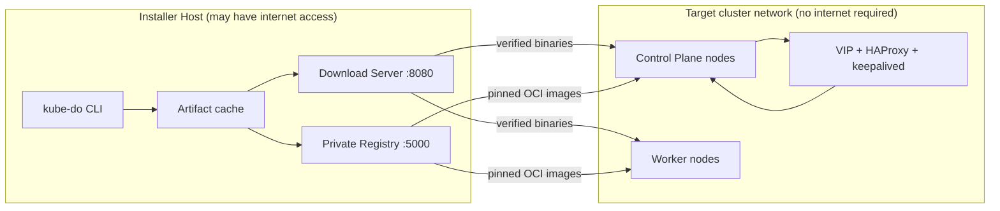

# kube-do

**English** | [简体中文](README.zh-CN.md)

[](https://github.com/kube-dosh/kube-do/actions/workflows/release.yml)
[](https://github.com/kube-dosh/kube-do/releases)
[](go.mod)


> **Reproducible Kubernetes installation for networks that cannot reach the internet.**

kube-do is an opinionated, air-gapped Kubernetes installer for RHEL-family and Debian-family Linux. It prepares, verifies, versions, and distributes every dependency needed to build a highly available Kubernetes cluster, then drives Ansible to perform the installation. Target nodes never need public internet access and do not install Kubernetes, containerd, runc, or CNI components from operating-system repositories.

The project is designed for isolated data centers, regulated environments, edge sites, and lab platforms where repeatability and explicit dependency control matter more than access to the latest upstream packages.

> [!WARNING]
> kube-do is under active development and is **not production-ready**. It currently supports fresh installations only; upgrades, node scaling, registry authentication, and long-running production validation are out of scope for the current release. Evaluate it in a disposable or non-critical environment first.

## Contents

- [Overview](#overview)
- [Why kube-do](#why-kube-do)
- [Architecture](#architecture)
- [Supported platforms](#supported-platforms)
- [Requirements](#requirements)
- [Quick start](#quick-start)
- [Configuration](#configuration)
- [CLI reference](#cli-reference)
- [Installation lifecycle](#installation-lifecycle)
- [Builds and release artifacts](#builds-and-release-artifacts)
- [Validation status](#validation-status)
- [Security and operational boundaries](#security-and-operational-boundaries)
- [Known limitations](#known-limitations)
- [Development](#development)
- [Documentation](#documentation)
- [Contributing](#contributing)
- [License](#license)

## Overview

kube-do separates installation into two layers:

- **Resource layer:** the `kube-do` CLI downloads and verifies artifacts, builds the HAProxy and keepalived images, deploys or reuses a private OCI registry, mirrors images, serves binaries over HTTP, and renders Ansible configuration.
- **Cluster layer:** Ansible configures hosts, installs containerd, configures the control-plane VIP and API load balancer, runs `kubeadm`, installs Cilium, and verifies the cluster.

The result is a repeatable workflow in which the installer host is the only machine that needs upstream network access. Every target node consumes a pinned set of artifacts from the installer host.

### At a glance

| Area | Current implementation |
| --- | --- |
| Control plane | Three-node kubeadm control plane with a keepalived VIP and HAProxy API endpoint |
| Container runtime | containerd and runc from the pinned Resource Manifest |
| Networking | Cilium with kube-proxy replacement |
| Image distribution | CNCF Distribution registry over HTTPS with a private CA |
| Installer interface | Go CLI plus Ansible playbooks |
| Default resource Build | `v1.36.5-kube-do.1` |
| Kubernetes baseline | Kubernetes `v1.36.5`, Cilium `1.20.2` |
| CLI platforms | Linux `amd64` and `arm64` release builds |
| Target OS families | RHEL-family 9 and Debian-family Linux |

## Why kube-do

- **Offline by design.** Target nodes pull binaries and images only from the installer host. They do not require public DNS, internet access, Docker, or upstream package repositories.
- **Pinned, reproducible resource sets.** A **Build** groups Kubernetes, binaries, Helm charts, and container images into one immutable resource version.
- **One user-facing configuration.** Operators maintain a single `cluster.yaml`; Ansible inventory and variables are generated from it.
- **Highly available control plane from the start.** HAProxy and keepalived are prepared before kubeadm initializes the cluster, so the Kubernetes API remains reachable during bootstrap and after node loss.
- **No Docker dependency.** Registry and HA components use native binaries or containerd-managed containers.
- **Verification at every handoff.** Downloads are checked against SHA-256 values; generated HA artifacts are tracked with build metadata; configuration and cached artifacts can be validated before installation.
- **Release automation.** GitHub Releases publish tested Linux `amd64` and `arm64` CLI archives with checksums.

## Architecture



The installer host provides two network services during bootstrap:

- **Download Server (`:8080`)** serves verified binaries and build checksums over HTTP.
- **Private Registry (`:5000`)** serves container images over HTTPS and is trusted by target nodes through a private CA.

The control plane exposes Kubernetes through `<VIP>:<apiPort>`. HAProxy runs on every control-plane node and forwards traffic to the local `kube-apiserver`; keepalived manages the VIP. Both run as containerd-managed containers before the Kubernetes cluster exists.

## Supported platforms

### Target operating systems

| Manifest family | Supported distributions | Notes |
| --- | --- | --- |
| `rhel` | RHEL-family 9, Rocky Linux 9, Fedora 44 | Fedora 44 is supported only when the installer host and all targets use Fedora 44. |
| `debian` | Debian 12/13, Ubuntu 22.04/24.04 | The Debian family covers SELinux, firewall, swap, and package-manager differences. |

Supported CPU architectures are `amd64` (`x86_64`) and `arm64` (`aarch64`). One Build can carry artifacts for both architectures, but the installer host must use the same architecture as the target cluster because HAProxy and keepalived are built natively on the installer host.

### End-to-end validation status

| Platform | Status |
| --- | --- |
| Rocky Linux 9.8 / `amd64` | End-to-end air-gapped installation validated with three control-plane nodes and one worker. |
| Debian 12 / `amd64` | End-to-end air-gapped installation validated. |
| Fedora 44 / `amd64` | Lab installation validated with three control-plane nodes and five workers. |
| Debian 13, Ubuntu 22.04/24.04 | Supported by the code, Ansible paths, and resource checks; end-to-end installation still needs validation. |
| All `arm64` targets | Resource and build paths are implemented; full cluster installation and HA image execution still need validation. |

See [Validation status](#validation-status) for the detailed scope and known gaps.

## Requirements

### Installer host

- Linux on the same CPU architecture as the target cluster.
- Root or passwordless sudo for Registry deployment, cache preparation, Download Server, and Ansible execution.
- Outbound network access to upstream artifact and image sources when preparing a new Build.
- `ansible-playbook` available on `PATH`.
- `gcc`, `make`, `pkg-config`, and OpenSSL development headers for native HAProxy and keepalived builds. On RHEL-family systems this is typically `openssl-devel`; on Debian-family systems it is `libssl-dev`.
- SSH access to every control-plane and worker node. Key-based authentication is recommended.
- Synchronized clocks across the installer host and all target nodes. kube-do does not configure NTP.
- A C library on the installer host that is **not newer** than the target nodes. HAProxy and keepalived images contain libraries from the build host and can fail with `GLIBC_x.y not found` if the ABI is incompatible.

When installing from source, Go 1.27 is required. Release binaries are statically linked with `CGO_ENABLED=0` and do not require Go on the installer host.

### Target nodes

- A supported RHEL-family or Debian-family distribution matching `cluster.yaml`.
- Root SSH access and Python 3 for Ansible. On Debian and Ubuntu, Python 3 must already be installed.
- At least 20 GiB total and 5 GiB free on the root filesystem. At least 50 GiB is recommended for control-plane nodes. Low-latency storage is strongly recommended for etcd.
- Network access to the installer host on TCP `8080` and `5000`.
- Network access to `<VIP>:<apiPort>` from every node, local TCP `6443` on control-plane nodes, and VRRP protocol `112` between control-plane nodes.
- Standard system utilities including `ip`, `pgrep`, `mount`, `cp`, `modprobe`, `sysctl`, `swapoff`, `sha256sum`, `tar`, `gzip`, and `systemctl`. RHEL-family targets also require `getenforce` and `setenforce`.

> [!IMPORTANT]
> kube-do takes ownership of host configuration. During installation it disables swap and zram, disables firewalld or ufw, and disables SELinux on RHEL-family targets. Use dedicated nodes and review these behaviors before running the installer in an existing environment.

Target nodes do not need public internet access or a working upstream DNS resolver. If `/etc/resolv.conf` is missing, the prerequisites role creates a placeholder and derives cluster DNS forwarding from any available non-loopback resolver.

## Quick start

The commands below assume that `cluster.yaml` has been prepared for your environment and that `kube-do` is run from the repository root or installed on `PATH`.

### 1. Install the CLI

Download a release archive from [GitHub Releases](https://github.com/kube-dosh/kube-do/releases), or build from source:

```bash
git clone git@github.com:kube-dosh/kube-do.git
cd kube-do
CGO_ENABLED=0 go build -trimpath -o kube-do ./cmd/kube-do
sudo install -m 0755 kube-do /usr/local/bin/kube-do
kube-do version
```

### 2. Create and validate the cluster configuration

```bash
cp examples/cluster.yaml cluster.yaml
$EDITOR cluster.yaml
kube-do check --config cluster.yaml
```

`check` validates the configuration and the embedded Resource Manifest. Before artifacts are downloaded it reports them as missing, but the command still verifies that the selected Build, platform, and configuration are internally consistent.

### 3. Download node binaries and build HA artifacts

```bash
sudo kube-do download \
  --config cluster.yaml \
  --binaries-only \
  --cache-dir /var/cache/kube-do
```

This step downloads the target-platform binaries, builds HAProxy and keepalived from pinned sources, and records reproducible build metadata. The HA binaries are inputs to the Installer images and are not distributed directly to target nodes.

### 4. Deploy or reuse the private registry

```bash
sudo kube-do registry \
  --config cluster.yaml \
  --cache-dir /var/cache/kube-do
```

If the configured registry already responds over HTTPS, kube-do reuses it. Otherwise, kube-do installs CNCF Distribution, generates a private CA and server certificate, and starts a systemd service. Use `--dry-run --output-dir registry-bundle` to inspect the generated bundle without modifying the host.

### 5. Mirror container images

```bash
sudo kube-do download \
  --config cluster.yaml \
  --images-only \
  --cache-dir /var/cache/kube-do
```

Node images are copied directly between registries without being written to local disk, preserving multi-architecture manifest indexes. Installer images for HAProxy and keepalived are assembled from the locally built binaries and their runtime libraries.

### 6. Serve artifacts and install the cluster

Keep the Download Server running in a separate terminal:

```bash
sudo kube-do serve --dir /var/cache/kube-do --addr :8080
```

Then validate the registry and start the installation:

```bash
sudo kube-do check \
  --config cluster.yaml \
  --cache-dir /var/cache/kube-do \
  --registry

sudo kube-do install --config cluster.yaml
```

Useful installation options:

```bash
sudo kube-do install --config cluster.yaml --check       # Ansible check mode
sudo kube-do install --config cluster.yaml -v            # Increase Ansible verbosity
sudo kube-do install --config cluster.yaml --tags ha     # Run selected tags only
sudo kube-do install --config cluster.yaml --limit cp-1  # Limit the target hosts
sudo kube-do install --config cluster.yaml --skip-render # Reuse the rendered inventory
```

The Download Server must remain available until installation finishes. It provides plain HTTP without authentication and should be exposed only on a controlled management network.

## Configuration

The complete example is available at [examples/cluster.yaml](examples/cluster.yaml). Configuration is decoded with strict field checking: unknown or misspelled fields are rejected.

```yaml
apiVersion: kube-do.io/v1alpha1
kind: ClusterConfig
metadata:
  name: demo

build: v1.36.5-kube-do.1

platform:
  osFamily: rhel   # rhel | debian
  arch: amd64      # amd64 | arm64

installer:
  address: 10.0.0.10
  downloadPort: 8080

registry:
  address: 10.0.0.10:5000
  dataDir: /var/lib/kube-do/registry
  tls:
    mode: selfSigned

ssh:
  user: root
  port: 22
  # privateKeyFile: /root/.ssh/kube-do

controlPlane:
  vip: 10.0.0.100
  apiPort: 16443
  vrrp:
    routerId: 51
    password: kube-do
  nodes:
    - name: cp-1
      address: 10.0.0.11
    - name: cp-2
      address: 10.0.0.12
    - name: cp-3
      address: 10.0.0.13

workers:
  - name: worker-1
    address: 10.0.0.21
  - name: worker-2
    address: 10.0.0.22

cni:
  name: cilium
  kubeProxyReplacement: true
  podCIDR: 10.244.0.0/16
  serviceCIDR: 10.96.0.0/12
  clusterDomain: cluster.local
```

### Defaults

| Field | Default | Description |
| --- | --- | --- |
| `platform.osFamily` | `rhel` | `rhel` or `debian` |
| `platform.arch` | `amd64` | `amd64` or `arm64`; must match the manifest, target nodes, and installer host |
| `installer.downloadPort` | `8080` | Download Server port |
| `ssh.user` | `root` | Ansible SSH user |
| `ssh.port` | `22` | Ansible SSH port |
| `registry.dataDir` | `/var/lib/kube-do/registry` | Absolute path for registry data |
| `registry.tls.mode` | `selfSigned` | `selfSigned` or `provided` |
| `controlPlane.apiPort` | `16443` | HAProxy API endpoint; must not be `6443` |
| `controlPlane.vrrp.routerId` | `51` | VRRP router ID, 1-255 |
| `controlPlane.vrrp.password` | `kube-do` | VRRPv2 password, 1-8 characters: letters, digits, `.`, `_`, or `-` |
| `cni.name` | `cilium` | Currently the only supported CNI |
| `cni.kubeProxyReplacement` | `true` | Must currently be enabled |
| `cni.podCIDR` | `10.244.0.0/16` | Pod network |
| `cni.serviceCIDR` | `10.96.0.0/12` | Service network |
| `cni.clusterDomain` | `cluster.local` | Cluster DNS domain |

`controlPlane.apiPort` cannot be `6443` because kube-apiserver already listens on that port on every control-plane node. The control-plane endpoint is rendered as `https://<VIP>:<apiPort>`.

### Validation rules

- Cluster, node, and DNS names must be valid lowercase DNS names.
- Node and VIP addresses must be IPv4; names and addresses must be unique.
- `installer.address` must be a host or IP without a scheme or port; `registry.address` must be `host:port`.
- `registry.dataDir` and provided TLS file paths must be absolute.
- Pod and Service CIDRs must be valid, non-overlapping IPv4 networks that do not contain any node address or the control-plane VIP.
- `build` must be a safe single path segment.
- The selected platform must exist in the Resource Manifest.
- `cluster.yaml` and each Resource Manifest must contain exactly one YAML document.

### Registry TLS

- **`selfSigned`** generates an ECDSA P-256 CA, server certificate, and private key. The trust anchor is stored at `/etc/kube-do/registry/tls/ca.crt`, and target nodes trust it through containerd's `hosts.toml`. External TLS files are rejected in this mode.
- **`provided`** reuses an existing certificate chain. `caFile`, `certFile`, and `keyFile` are all required and must be absolute paths. The CA is also used by the CLI when probing the registry.

Existing self-signed certificates are checked for SANs, validity, certificate chain, and key consistency. If the registry address changes or the certificate is no longer valid, kube-do generates a replacement instead of silently reusing it.

The registry does not implement authentication or RBAC. Anyone who can reach port `5000` can push or pull images, so deploy it only on a trusted management network.

## CLI reference

| Command | Purpose |
| --- | --- |
| `kube-do version` | Print version, commit, and build time |
| `kube-do check` | Validate `cluster.yaml`, the Resource Manifest, input files, cached artifacts and build metadata; optionally probe the registry |
| `kube-do download` | Download binaries, build HA images, and mirror node images |
| `kube-do registry` | Deploy or reuse the private registry |
| `kube-do serve` | Serve cached artifacts over HTTP |
| `kube-do render` | Generate the Ansible inventory and group variables |
| `kube-do install` | Run the Ansible installation |
| `kube-do manifest bump` | Create a new Resource Manifest from explicit component versions |

Use `kube-do <command> --help` for the complete flag set.

## Installation lifecycle

`kube-do install` renders the inventory and runs `ansible/site.yml`. The playbook is organized by Ansible tags:

| Tag | Responsibility |
| --- | --- |
| `prerequisites` | Validate platform, disable swap and zram, adjust firewall and SELinux, load kernel modules |
| `containerd` | Install pinned containerd, runc, CNI plugins, and crictl |
| `kubernetes` | Install pinned kubeadm, kubelet, and kubectl |
| `ha` | Configure HAProxy and keepalived containers and the control-plane VIP |
| `init` | Initialize the first control-plane node |
| `join` | Join additional control-plane nodes and workers |
| `cilium` | Install Cilium with kube-proxy replacement |
| `verify` | Wait for nodes, Cilium, CoreDNS, and Hubble Relay to become ready |

The Cilium stage uses `helm --atomic --wait` and cleans up pending or failed Helm releases before retrying. The installer does not reboot nodes automatically; SELinux persistence may require a maintenance reboot after installation.

## Builds and release artifacts

### Builds versus releases

- A **Build** versions the offline artifact set, for example `v1.36.5-kube-do.1`.
- A **release tag** versions the `kube-do` CLI and its published release assets.

They are independent. Updating the CLI does not automatically change the Resource Manifest, and creating a new Build does not require a new CLI release unless the CLI behavior also changes.

### Resource Manifest

Each Build is described by a YAML Resource Manifest under `manifests/builds/` and embedded into the CLI with `go:embed`. A manifest pins supported platforms, node binaries, installer binaries, generated installer images, and node images. Custom manifests can be supplied with `--manifest`.

Create a new Build without modifying the base manifest:

```bash
# Preview the generated manifest
kube-do manifest bump \
  --kubernetes 1.36.6 \
  --cilium 1.20.2 \
  --dry-run

# Write a new manifest and rebuild the CLI to embed it
kube-do manifest bump \
  --kubernetes 1.36.6 \
  --cilium 1.20.2
CGO_ENABLED=0 go build -trimpath -o kube-do ./cmd/kube-do
```

The `bump` command can update Kubernetes, Cilium, containerd, runc, CNI plugins, crictl, Helm, Cilium CLI, Distribution, HAProxy, and keepalived versions. It recalculates binary checksums, resolves dependent image versions, and never modifies the base manifest in place. Review the generated manifest before publishing it.

### Artifact cache

The cache can be selected with `--cache-dir`, `KUBE_DO_CACHE_DIR`, `$XDG_CACHE_HOME/kube-do`, or `~/.cache/kube-do` in that order of precedence.

```text
<cache-dir>/artifacts/<build>/<os>-<arch>/<name>
<cache-dir>/artifacts/<build>/<os>-<arch>/<name>.sha256
<cache-dir>/artifacts/<build>/<os>-<arch>/.<name>.build.json
```

Regular binaries are verified against the manifest SHA-256. Build products are reused only when the binary, checksum sidecar, and build marker agree; `check` fails when the sidecar or marker is malformed or inconsistent.

### CLI release assets

The [Release workflow](.github/workflows/release.yml) runs when a GitHub Release is published. It checks formatting, runs `go vet`, executes the race-enabled test suite, and builds static Linux binaries for `amd64` and `arm64` with version, commit, and build time injected through linker flags.

Assets are named as follows:

```text
kube-do_<release-tag>_linux_amd64.tar.gz
kube-do_<release-tag>_linux_arm64.tar.gz
checksums.txt
```

Verify downloaded assets before use:

```bash
sha256sum -c checksums.txt
```

## Validation status

The project has been tested in isolated libvirt/QEMU environments using blank RHEL-family and Debian-family cloud images. The target nodes had no public internet access during installation.

Validated scenarios include:

- Fresh Rocky Linux 9.8 `amd64` installation with three control-plane nodes and one worker.
- Fresh Debian 12 `amd64` installation with the same topology.
- Containerized HAProxy and keepalived, including VIP failover and node reboot recovery.
- Cilium kube-proxy replacement, CoreDNS, and Hubble Relay readiness.
- Fedora 44 `amd64` lab installation with three control-plane nodes and five workers.

Still unvalidated:

- Physical RHEL 9 hardware, non-default MTUs, complex switch topologies, and production network behavior.
- End-to-end installation of Debian 13, Ubuntu 22.04/24.04, and all `arm64` targets.
- Arbitrary installer/target glibc ABI combinations.
- Long-running stability, abrupt power-loss recovery, and every interrupted-installation recovery path.

The automated tests cover configuration parsing, manifest validation, archive extraction safety, downloads, registry handling, rendering, and installation command construction.

## Security and operational boundaries

kube-do is intended for controlled, isolated environments. Before using it, review the following operational characteristics:

- The Download Server uses plain HTTP without authentication.
- The private registry uses TLS but no authentication or authorization.
- HAProxy and keepalived run with `hostNetwork`; keepalived also uses `hostPID` and additional network capabilities.
- RHEL-family target nodes have SELinux disabled by design.
- Swap, zram, firewalld, and ufw are disabled on target nodes.
- HAProxy and keepalived images inherit runtime libraries from the installer host and must be built in an ABI-compatible environment.

Use a dedicated management network, restrict access to ports `8080` and `5000`, and do not expose the installer host directly to untrusted networks.

## Known limitations

- No in-place Kubernetes upgrades or Build rollback.
- No node scaling or node removal workflow.
- No registry authentication, RBAC, web UI, or replication.
- No supported cross-architecture build path for HAProxy and keepalived images.
- No non-Linux target support.
- No built-in SCP artifact distribution path.
- No production hardening or long-term support guarantee yet.

## Development

Prerequisites: Go 1.27 and the native HA build dependencies listed above. Ansible is required only when running the installation playbook.

```bash
CGO_ENABLED=0 go build -trimpath -o kube-do ./cmd/kube-do
gofmt -l ./cmd ./internal ./manifests
go vet ./...
go test ./...
go test -race ./...
```

Generate the Ansible inventory and run a syntax check:

```bash
kube-do render --config cluster.yaml --out rendered
cd ansible
ansible-playbook -i ../rendered/inventory.ini --syntax-check site.yml
```

### Repository layout

```text
kube-do/
├── cmd/kube-do/            # CLI entry point
├── internal/               # download, registry, manifest, render, install, and verification logic
├── manifests/builds/       # one Resource Manifest per Build
├── examples/cluster.yaml   # example user configuration
├── ansible/                # playbook, roles, and templates
├── docs/adr/               # architecture decision records
├── .github/workflows/      # release automation
├── GLOSSARY.md
├── README.md
└── README.zh-CN.md
```

Generated directories such as `rendered/`, `dist/`, `registry-bundle*/`, and local `cluster*.yaml` files are ignored by Git.

## Documentation

- [Glossary](GLOSSARY.md)
- [Architecture decision records](docs/adr)
- [Example cluster configuration](examples/cluster.yaml)
- [Release workflow](.github/workflows/release.yml)

Key architecture decisions:

- [ADR-0001: Resource layer versus cluster layer](docs/adr/0001-kube-do-resource-layer-ansible-cluster-layer.md)
- [ADR-0002: SELinux disabled on target nodes](docs/adr/0002-selinux-disabled-on-target-nodes.md)
- [ADR-0003: First Build baseline](docs/adr/0003-first-build-baseline-k8s-1.36-cilium-1.20.md)
- [ADR-0004: CNCF Distribution instead of Harbor](docs/adr/0004-registry-is-distribution-not-harbor.md)
- [ADR-0005: Installer host ABI compatibility](docs/adr/0005-installer-host-build-abi.md)
- [ADR-0006: Multi-platform manifests](docs/adr/0006-multi-platform-manifest-and-debian-arm64.md)
- [ADR-0007: Containerized HAProxy and keepalived](docs/adr/0007-keepalived-runs-as-containerd-container.md)

## Contributing

Contributions are welcome through issues and pull requests in the [kube-dosh/kube-do repository](https://github.com/kube-dosh/kube-do).

Please include:

- A clear description of the problem and the expected behavior.
- Reproduction steps or test coverage where possible.
- Validation results for changes that affect installation, host configuration, or artifact handling.
- Updates to the glossary or ADRs when terminology or architectural behavior changes.

Before submitting a pull request, run formatting, vet, and tests with the commands in [Development](#development).

## License

No `LICENSE` file has been added to this repository yet. Until a license is selected and published, the source code does not grant redistribution or reuse rights beyond the terms provided by the repository owner. Add an explicit license before distributing kube-do outside your organization.
