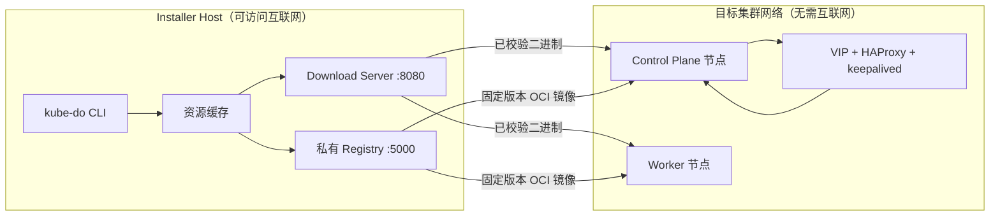

# kube-do

[English](README.md) | **简体中文**

[](https://github.com/kube-dosh/kube-do/actions/workflows/release.yml)
[](https://github.com/kube-dosh/kube-do/releases)
[](go.mod)


> **面向无法访问互联网的网络环境，提供可复现的 Kubernetes 安装能力。**

kube-do 是一个面向 RHEL 系与 Debian 系 Linux 的离线（air-gapped）Kubernetes 安装器。它负责准备、校验、版本化和分发构建高可用 Kubernetes 集群所需的全部依赖，再通过 Ansible 完成安装。目标节点无需访问公网，也不需要从操作系统软件仓库安装 Kubernetes、containerd、runc 或 CNI 组件。

kube-do 适用于隔离数据中心、合规环境、边缘站点，以及强调可重复性和依赖可控性的实验平台。

> [!WARNING]
> kube-do 仍在积极开发中，**尚未达到生产可用标准**。当前版本只支持全新安装；原地升级、节点扩缩容、Registry 认证和长期生产环境验证不在当前范围内。请先在可丢弃或非关键环境中评估。

## 目录

- [概览](#概览)
- [为什么选择 kube-do](#为什么选择-kube-do)
- [架构](#架构)
- [支持平台](#支持平台)
- [环境要求](#环境要求)
- [快速开始](#快速开始)
- [配置](#配置)
- [CLI 命令](#cli-命令)
- [安装生命周期](#安装生命周期)
- [Build 与发布产物](#build-与发布产物)
- [验证状态](#验证状态)
- [安全与运维边界](#安全与运维边界)
- [已知限制](#已知限制)
- [开发](#开发)
- [文档](#文档)
- [贡献](#贡献)
- [许可证](#许可证)

## 概览

kube-do 将安装过程分为两层：

- **资源层：** `kube-do` CLI 下载并校验资源，构建 HAProxy 与 keepalived 镜像，部署或复用私有 OCI Registry，搬运镜像，通过 HTTP 提供二进制下载，并渲染 Ansible 配置。
- **集群层：** Ansible 配置主机、安装 containerd、配置控制平面 VIP 与 API 负载均衡、执行 `kubeadm`、安装 Cilium，并验证集群状态。

最终形成的可重复流程中，只有安装机（Installer Host）需要访问上游网络；所有目标节点只从安装机获取固定版本的资源。

### 项目速览

| 项目 | 当前实现 |
| --- | --- |
| 控制平面 | 三节点 kubeadm 控制平面，keepalived VIP 与 HAProxy API 入口 |
| 容器运行时 | 由 Resource Manifest 固定版本的 containerd 与 runc |
| 网络 | 启用 kube-proxy replacement 的 Cilium |
| 镜像分发 | 使用私有 CA 的 HTTPS CNCF Distribution Registry |
| 安装接口 | Go CLI 与 Ansible Playbook |
| 默认资源 Build | `v1.36.5-kube-do.1` |
| Kubernetes 基线 | Kubernetes `v1.36.5`、Cilium `1.20.2` |
| CLI 发布平台 | Linux `amd64` 与 `arm64` |
| 目标操作系统 | RHEL 系 9 与 Debian 系 Linux |

## 为什么选择 kube-do

- **离线优先。** 目标节点只从安装机拉取二进制和镜像，不需要公网 DNS、互联网访问、Docker 或上游软件仓库。
- **固定且可复现的资源集合。** 一个 **Build** 将 Kubernetes、二进制、Helm Chart 和容器镜像固定为同一个不可变资源版本。
- **单一配置入口。** 运维人员只需维护一个 `cluster.yaml`，Ansible Inventory 与变量由 kube-do 生成。
- **从启动阶段就具备高可用控制平面。** HAProxy 与 keepalived 在 kubeadm 初始化之前完成准备，使 Kubernetes API 在引导期间和节点故障后仍然可达。
- **不依赖 Docker。** Registry 使用原生二进制，HA 组件通过 containerd 托管容器运行。
- **在每次交接处进行校验。** 下载文件按 SHA-256 校验；HA 构建产物带构建元数据；安装前可检查配置与缓存资源。
- **自动发布。** GitHub Release 会自动构建并发布经过测试的 Linux `amd64`、`arm64` CLI 归档及校验文件。

## 架构



安装期间，安装机提供两个网络服务：

- **Download Server（`:8080`）** 通过 HTTP 提供经过校验的二进制文件与构建校验值。
- **私有 Registry（`:5000`）** 通过 HTTPS 提供容器镜像，目标节点通过私有 CA 建立信任。

控制平面通过 `<VIP>:<apiPort>` 暴露 Kubernetes API。每个控制平面节点上都运行 HAProxy，将请求转发到本机的 `kube-apiserver`；keepalived 负责管理 VIP。二者都由 containerd 托管，并在 Kubernetes 集群存在之前启动。

## 支持平台

### 目标操作系统

| Manifest 家族 | 支持的发行版 | 说明 |
| --- | --- | --- |
| `rhel` | RHEL 系 9、Rocky Linux 9、Fedora 44 | 仅当安装机与所有目标节点均为 Fedora 44 时支持 Fedora 44。 |
| `debian` | Debian 12/13、Ubuntu 22.04/24.04 | Debian 家族覆盖 SELinux、防火墙、Swap 与包管理器差异。 |

支持的 CPU 架构为 `amd64`（`x86_64`）与 `arm64`（`aarch64`）。一个 Build 可以同时包含两种架构的资源，但安装机必须与目标集群架构一致，因为 HAProxy 与 keepalived 在安装机上原生构建。

### 端到端验证状态

| 平台 | 状态 |
| --- | --- |
| Rocky Linux 9.8 / `amd64` | 已完成三控制平面 + 一 Worker 的离线端到端安装验证。 |
| Debian 12 / `amd64` | 已完成离线端到端安装验证。 |
| Fedora 44 / `amd64` | 已在三控制平面 + 五 Worker 的实验环境完成安装验证。 |
| Debian 13、Ubuntu 22.04/24.04 | 代码、Ansible 分支与资源校验已支持，仍需端到端安装验证。 |
| 所有 `arm64` 目标 | 资源与构建路径已实现；完整集群安装与 HA 镜像运行仍需验证。 |

详细范围与已知缺口见[验证状态](#验证状态)。

## 环境要求

### 安装机

- Linux，且 CPU 架构与目标集群一致。
- 部署 Registry、准备缓存、运行 Download Server 和执行 Ansible 需要 root 或免密 sudo 权限。
- 准备新 Build 时需要访问上游资源与镜像源。
- `PATH` 中可调用 `ansible-playbook`。
- 原生构建 HAProxy 与 keepalived 需要 `gcc`、`make`、`pkg-config` 与 OpenSSL 开发头文件。RHEL 系通常为 `openssl-devel`，Debian 系通常为 `libssl-dev`。
- 能通过 SSH 访问全部控制平面与 Worker 节点，推荐使用密钥认证。
- 安装机与所有目标节点启用时间同步。kube-do 不配置 NTP。
- 安装机的 C 运行库**不得新于**目标节点。HAProxy 与 keepalived 镜像包含构建机的动态库，ABI 不兼容时会出现 `GLIBC_x.y not found`。

从源码安装时要求 Go 1.27。发布版二进制使用 `CGO_ENABLED=0` 静态构建，安装机无需安装 Go。

### 目标节点

- 使用 `cluster.yaml` 声明的受支持 RHEL 系或 Debian 系发行版。
- 允许 root SSH 登录，并具备 Python 3 供 Ansible 使用。Debian 与 Ubuntu 目标必须预先安装 Python 3。
- 根文件系统至少 20 GiB 总量和 5 GiB 可用空间；控制平面节点建议至少 50 GiB。etcd 强烈建议使用低延迟存储。
- 能访问安装机的 TCP `8080` 与 `5000` 端口。
- 所有节点能访问 `<VIP>:<apiPort>`；控制平面节点本机开放 TCP `6443`；控制平面之间允许 VRRP 协议 `112`。
- 具备 `ip`、`pgrep`、`mount`、`cp`、`modprobe`、`sysctl`、`swapoff`、`sha256sum`、`tar`、`gzip`、`systemctl` 等基础命令。RHEL 系还需要 `getenforce` 与 `setenforce`。

> [!IMPORTANT]
> kube-do 会接管主机配置。安装过程中会关闭 Swap 与 zram，关闭 firewalld 或 ufw，并在 RHEL 系目标上禁用 SELinux。请使用专用节点，并在已有环境中运行前确认这些行为符合预期。

目标节点不需要公网访问，也不要求可用的上游 DNS。若 `/etc/resolv.conf` 不存在，前置角色会创建占位文件，并从可用的非 loopback 解析器提取集群 DNS 转发配置。

## 快速开始

以下命令假设 `cluster.yaml` 已按实际环境准备，并且 `kube-do` 位于仓库根目录或已安装到 `PATH`。

### 1. 安装 CLI

从 [GitHub Releases](https://github.com/kube-dosh/kube-do/releases) 下载发布归档，或从源码构建：

```bash
git clone git@github.com:kube-dosh/kube-do.git
cd kube-do
CGO_ENABLED=0 go build -trimpath -o kube-do ./cmd/kube-do
sudo install -m 0755 kube-do /usr/local/bin/kube-do
kube-do version
```

### 2. 创建并校验集群配置

```bash
cp examples/cluster.yaml cluster.yaml
$EDITOR cluster.yaml
kube-do check --config cluster.yaml
```

`check` 会校验配置与内嵌 Resource Manifest。下载资源之前，它会将资源报告为缺失，但仍会检查所选 Build、平台和配置之间是否一致。

### 3. 下载节点二进制并构建 HA 产物

```bash
sudo kube-do download \
  --config cluster.yaml \
  --binaries-only \
  --cache-dir /var/cache/kube-do
```

该步骤下载目标平台二进制，从固定源码构建 HAProxy 与 keepalived，并记录可复现的构建元数据。HA 二进制只作为 Installer 镜像的输入，不会直接分发到目标节点。

### 4. 部署或复用私有 Registry

```bash
sudo kube-do registry \
  --config cluster.yaml \
  --cache-dir /var/cache/kube-do
```

如果配置的 Registry 已能通过 HTTPS 响应，kube-do 会直接复用；否则会安装 CNCF Distribution，生成私有 CA 与服务端证书，并启动 systemd 服务。可使用 `--dry-run --output-dir registry-bundle` 在不修改主机的情况下检查生成的 bundle。

### 5. 搬运容器镜像

```bash
sudo kube-do download \
  --config cluster.yaml \
  --images-only \
  --cache-dir /var/cache/kube-do
```

节点镜像直接在两个 Registry 之间复制，不写入本地磁盘，并保留多架构 manifest index。HAProxy 与 keepalived 的 Installer 镜像由本机构建产物及其运行库组装而成。

### 6. 提供资源并安装集群

在单独终端中保持 Download Server 运行：

```bash
sudo kube-do serve --dir /var/cache/kube-do --addr :8080
```

随后校验 Registry 并开始安装：

```bash
sudo kube-do check \
  --config cluster.yaml \
  --cache-dir /var/cache/kube-do \
  --registry

sudo kube-do install --config cluster.yaml
```

常用安装选项：

```bash
sudo kube-do install --config cluster.yaml --check       # Ansible check 模式
sudo kube-do install --config cluster.yaml -v            # 提高 Ansible 详细度
sudo kube-do install --config cluster.yaml --tags ha     # 只执行指定标签
sudo kube-do install --config cluster.yaml --limit cp-1  # 限制目标主机
sudo kube-do install --config cluster.yaml --skip-render # 复用已有渲染结果
```

Download Server 必须持续运行到安装结束。该服务使用无认证的明文 HTTP，只应暴露在受控管理网络中。

## 配置

完整示例见 [examples/cluster.yaml](examples/cluster.yaml)。配置使用严格字段校验，未知或拼写错误的字段会直接报错。

```yaml
apiVersion: kube-do.io/v1alpha1
kind: ClusterConfig
metadata:
  name: demo

build: v1.36.5-kube-do.1

platform:
  osFamily: rhel   # rhel | debian
  arch: amd64      # amd64 | arm64

installer:
  address: 10.0.0.10
  downloadPort: 8080

registry:
  address: 10.0.0.10:5000
  dataDir: /var/lib/kube-do/registry
  tls:
    mode: selfSigned

ssh:
  user: root
  port: 22
  # privateKeyFile: /root/.ssh/kube-do

controlPlane:
  vip: 10.0.0.100
  apiPort: 16443
  vrrp:
    routerId: 51
    password: kube-do
  nodes:
    - name: cp-1
      address: 10.0.0.11
    - name: cp-2
      address: 10.0.0.12
    - name: cp-3
      address: 10.0.0.13

workers:
  - name: worker-1
    address: 10.0.0.21
  - name: worker-2
    address: 10.0.0.22

cni:
  name: cilium
  kubeProxyReplacement: true
  podCIDR: 10.244.0.0/16
  serviceCIDR: 10.96.0.0/12
  clusterDomain: cluster.local
```

### 默认值

| 字段 | 默认值 | 说明 |
| --- | --- | --- |
| `platform.osFamily` | `rhel` | `rhel` 或 `debian` |
| `platform.arch` | `amd64` | `amd64` 或 `arm64`；必须与 Manifest、目标节点和安装机一致 |
| `installer.downloadPort` | `8080` | Download Server 端口 |
| `ssh.user` | `root` | Ansible SSH 用户 |
| `ssh.port` | `22` | Ansible SSH 端口 |
| `registry.dataDir` | `/var/lib/kube-do/registry` | Registry 数据目录，必须是绝对路径 |
| `registry.tls.mode` | `selfSigned` | `selfSigned` 或 `provided` |
| `controlPlane.apiPort` | `16443` | HAProxy API 入口，禁止设置为 `6443` |
| `controlPlane.vrrp.routerId` | `51` | VRRP Router ID，范围 1-255 |
| `controlPlane.vrrp.password` | `kube-do` | VRRPv2 密码，1-8 个字符，仅限字母、数字、`.`、`_`、`-` |
| `cni.name` | `cilium` | 当前仅支持 Cilium |
| `cni.kubeProxyReplacement` | `true` | 当前必须启用 |
| `cni.podCIDR` | `10.244.0.0/16` | Pod 网段 |
| `cni.serviceCIDR` | `10.96.0.0/12` | Service 网段 |
| `cni.clusterDomain` | `cluster.local` | 集群 DNS 域 |

`controlPlane.apiPort` 不能为 `6443`，因为每个控制平面节点上的 kube-apiserver 已监听该端口。控制平面入口会渲染为 `https://<VIP>:<apiPort>`。

### 校验规则

- 集群名、节点名与 DNS 名称必须是合法的小写 DNS 名称。
- 节点地址与 VIP 必须是 IPv4，名称和地址不能重复。
- `installer.address` 只能填写主机名或 IP，不带 scheme 和端口；`registry.address` 必须是 `host:port`。
- `registry.dataDir` 与 `provided` 模式下的 TLS 文件路径必须是绝对路径。
- Pod 与 Service 网段必须是合法且不重叠的 IPv4 网络，并且不能包含任何节点地址或控制平面 VIP。
- `build` 必须是安全的单段路径名称。
- 所选平台必须存在于 Resource Manifest 中。
- `cluster.yaml` 与每份 Resource Manifest 都必须只包含一个 YAML 文档。

### Registry TLS

- **`selfSigned`** 生成 ECDSA P-256 CA、服务端证书和私钥。信任锚固定位于 `/etc/kube-do/registry/tls/ca.crt`，目标节点通过 containerd 的 `hosts.toml` 信任该 CA。此模式拒绝外部 TLS 文件。
- **`provided`** 复用已有证书链，必须同时提供绝对路径的 `caFile`、`certFile` 与 `keyFile`。CLI 探测 Registry 时也使用该 CA。

复用自签证书时会检查 SAN、有效期、证书链和私钥一致性。Registry 地址变化或证书失效时会自动重新生成，不会静默复用旧证书。

Registry 不提供认证或 RBAC。任何能访问 `5000` 端口的主体都可以推送或拉取镜像，因此只能部署在可信管理网络中。

## CLI 命令

| 命令 | 作用 |
| --- | --- |
| `kube-do version` | 输出版本、Commit 与构建时间 |
| `kube-do check` | 校验 `cluster.yaml`、Resource Manifest、输入文件、缓存资源与构建元数据，可选探测 Registry |
| `kube-do download` | 下载二进制、构建 HA 镜像并搬运节点镜像 |
| `kube-do registry` | 部署或复用私有 Registry |
| `kube-do serve` | 通过 HTTP 提供缓存资源 |
| `kube-do render` | 生成 Ansible Inventory 与 Group Variables |
| `kube-do install` | 执行 Ansible 安装 |
| `kube-do manifest bump` | 按显式组件版本生成新的 Resource Manifest |

完整参数请执行 `kube-do <command> --help`。

## 安装生命周期

`kube-do install` 会先渲染 Inventory，再执行 `ansible/site.yml`。Playbook 按 Ansible Tag 组织：

| Tag | 职责 |
| --- | --- |
| `prerequisites` | 校验平台，关闭 Swap 与 zram，调整防火墙与 SELinux，加载内核模块 |
| `containerd` | 安装固定版本的 containerd、runc、CNI Plugins 与 crictl |
| `kubernetes` | 安装固定版本的 kubeadm、kubelet 与 kubectl |
| `ha` | 配置 HAProxy、keepalived 容器与控制平面 VIP |
| `init` | 初始化第一个控制平面节点 |
| `join` | 加入其余控制平面节点与 Worker |
| `cilium` | 安装启用 kube-proxy replacement 的 Cilium |
| `verify` | 等待节点、Cilium、CoreDNS 与 Hubble Relay 就绪 |

Cilium 阶段使用 `helm --atomic --wait`，并在重试前清理 pending 或 failed 的 Helm Release。安装器不会自动重启节点；SELinux 的持久化配置可能需要后续维护窗口重启才能完全生效。

## Build 与发布产物

### Build 与 Release 的区别

- **Build** 表示离线资源集合的版本，例如 `v1.36.5-kube-do.1`。
- **Release Tag** 表示 `kube-do` CLI 及其发布产物的版本。

两者相互独立。更新 CLI 不会自动修改 Resource Manifest；创建新 Build 也不一定需要发布新的 CLI，除非 CLI 行为同时发生变化。

### Resource Manifest

每个 Build 对应 `manifests/builds/` 下的一份 YAML Resource Manifest，并通过 `go:embed` 编入 CLI。Manifest 固定支持的平台、节点二进制、安装机二进制、Installer 生成镜像与节点镜像。可通过 `--manifest` 指定自定义清单。

在不修改基础清单的情况下生成新 Build：

```bash
# 预览生成的 Manifest
kube-do manifest bump \
  --kubernetes 1.36.6 \
  --cilium 1.20.2 \
  --dry-run

# 写入新 Manifest，并重新构建 CLI 以内嵌该清单
kube-do manifest bump \
  --kubernetes 1.36.6 \
  --cilium 1.20.2
CGO_ENABLED=0 go build -trimpath -o kube-do ./cmd/kube-do
```

`bump` 可更新 Kubernetes、Cilium、containerd、runc、CNI Plugins、crictl、Helm、Cilium CLI、Distribution、HAProxy 与 keepalived 版本。它会重新计算二进制校验值、解析依赖镜像版本，并且不会原地修改基础 Manifest。发布前应人工审查生成的清单。

### 资源缓存

缓存目录按以下优先级选择：`--cache-dir`、`KUBE_DO_CACHE_DIR`、`$XDG_CACHE_HOME/kube-do`、`~/.cache/kube-do`。

```text
<cache-dir>/artifacts/<build>/<os>-<arch>/<name>
<cache-dir>/artifacts/<build>/<os>-<arch>/<name>.sha256
<cache-dir>/artifacts/<build>/<os>-<arch>/.<name>.build.json
```

普通二进制按 Manifest 中的 SHA-256 校验。构建型产物只有在校验文件、sidecar 与 build marker 一致时才会复用；若 sidecar 或 marker 格式错误、内容不一致，`check` 会失败。

### CLI 发布产物

发布 GitHub Release 时，[Release 工作流](.github/workflows/release.yml)会检查格式、运行 `go vet` 与启用了竞态检测的测试，并为 `amd64` 与 `arm64` 构建静态 Linux 二进制，通过链接参数注入版本、Commit 与构建时间。

发布资产命名如下：

```text
kube-do_<release-tag>_linux_amd64.tar.gz
kube-do_<release-tag>_linux_arm64.tar.gz
checksums.txt
```

使用前校验下载产物：

```bash
sha256sum -c checksums.txt
```

## 验证状态

项目已在隔离的 libvirt/QEMU 环境中使用空白 RHEL 系与 Debian 系 Cloud Image 进行测试。安装期间目标节点无法访问公网。

已验证场景包括：

- Rocky Linux 9.8 `amd64` 三控制平面 + 一 Worker 的全新离线安装。
- Debian 12 `amd64` 相同拓扑的全新安装。
- 容器化 HAProxy 与 keepalived，包括 VIP 故障切换与节点重启恢复。
- Cilium kube-proxy replacement、CoreDNS 与 Hubble Relay 就绪。
- Fedora 44 `amd64` 三控制平面 + 五 Worker 实验环境安装。

尚未验证：

- 真实 RHEL 9 物理机、非默认 MTU、复杂交换网络与生产网络行为。
- Debian 13、Ubuntu 22.04/24.04 与所有 `arm64` 目标的端到端安装。
- 任意安装机与目标机 glibc ABI 组合。
- 长期稳定性、突然断电恢复，以及所有安装中断场景的自动续跑。

自动化测试覆盖配置解析、Manifest 校验、归档解压安全、下载、Registry 操作、渲染与安装命令构造。

## 安全与运维边界

kube-do 面向受控的隔离环境。使用前请确认以下运维特征：

- Download Server 使用无认证的明文 HTTP。
- 私有 Registry 使用 TLS，但不提供认证或授权。
- HAProxy 与 keepalived 使用 `hostNetwork`；keepalived 还使用 `hostPID` 和额外网络 Capability。
- RHEL 系目标节点会按设计禁用 SELinux。
- 目标节点会关闭 Swap、zram、firewalld 与 ufw。
- HAProxy 与 keepalived 镜像继承安装机的运行库，必须在 ABI 兼容环境中构建。

请使用专用管理网络，限制对 `8080` 与 `5000` 端口的访问，并避免将安装机直接暴露到不可信网络。

## 已知限制

- 不支持 Kubernetes 原地升级或 Build 回滚。
- 不支持节点扩容、缩容或移除。
- Registry 不支持认证、RBAC、Web UI 或复制。
- 不支持 HAProxy 与 keepalived 镜像的跨架构构建。
- 不支持非 Linux 目标节点。
- 不内置 SCP 资源分发路径。
- 尚未完成生产级加固，也不提供长期支持保证。

## 开发

前置条件：Go 1.27，以及上文列出的 HA 原生构建依赖。只有执行安装 Playbook 时才需要 Ansible。

```bash
CGO_ENABLED=0 go build -trimpath -o kube-do ./cmd/kube-do
gofmt -l ./cmd ./internal ./manifests
go vet ./...
go test ./...
go test -race ./...
```

生成 Ansible Inventory 并执行语法检查：

```bash
kube-do render --config cluster.yaml --out rendered
cd ansible
ansible-playbook -i ../rendered/inventory.ini --syntax-check site.yml
```

### 仓库结构

```text
kube-do/
├── cmd/kube-do/            # CLI 入口
├── internal/               # 下载、Registry、Manifest、渲染、安装与校验逻辑
├── manifests/builds/       # 每个 Build 一份 Resource Manifest
├── examples/cluster.yaml   # 用户配置示例
├── ansible/                # Playbook、角色与模板
├── docs/adr/               # 架构决策记录
├── .github/workflows/      # 发布自动化
├── GLOSSARY.md
├── README.md
└── README.zh-CN.md
```

`rendered/`、`dist/`、`registry-bundle*/` 与本地 `cluster*.yaml` 等生成目录或文件已由 Git 忽略。

## 文档

- [术语表](GLOSSARY.md)
- [架构决策记录](docs/adr)
- [集群配置示例](examples/cluster.yaml)
- [发布工作流](.github/workflows/release.yml)

关键架构决策：

- [ADR-0001：资源层与集群层分离](docs/adr/0001-kube-do-resource-layer-ansible-cluster-layer.md)
- [ADR-0002：目标节点禁用 SELinux](docs/adr/0002-selinux-disabled-on-target-nodes.md)
- [ADR-0003：首个 Build 的版本基线](docs/adr/0003-first-build-baseline-k8s-1.36-cilium-1.20.md)
- [ADR-0004：使用 CNCF Distribution 而非 Harbor](docs/adr/0004-registry-is-distribution-not-harbor.md)
- [ADR-0005：安装机 ABI 兼容性](docs/adr/0005-installer-host-build-abi.md)
- [ADR-0006：多平台 Manifest](docs/adr/0006-multi-platform-manifest-and-debian-arm64.md)
- [ADR-0007：容器化 HAProxy 与 keepalived](docs/adr/0007-keepalived-runs-as-containerd-container.md)

## 贡献

欢迎通过 [kube-dosh/kube-do](https://github.com/kube-dosh/kube-do) 仓库的 Issue 与 Pull Request 参与贡献。

提交时请尽量包含：

- 对问题与预期行为的清晰描述。
- 可复现步骤或相应测试。
- 涉及安装流程、主机配置或资源处理时的验证结果。
- 术语或架构行为变化时，对术语表或 ADR 的同步更新。

提交 Pull Request 前，请执行[开发](#开发)章节中的格式化、vet 与测试命令。

## 许可证

当前仓库尚未添加 `LICENSE` 文件。在选择并发布许可证之前，源代码不会授予仓库所有者条款之外的再分发或复用权利。若计划在组织外部分发 kube-do，请先补充明确的许可证。
